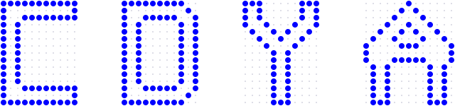
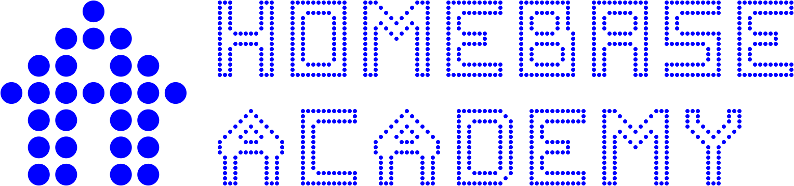
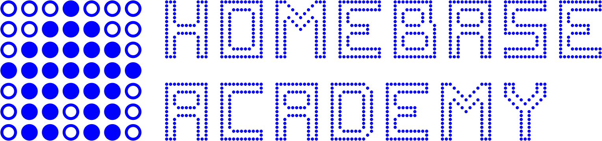
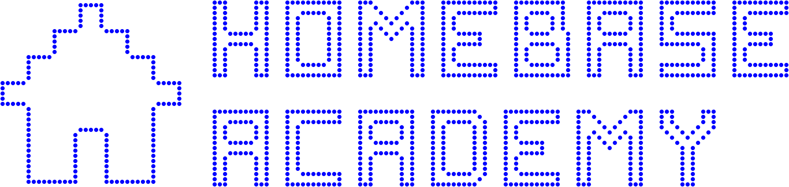
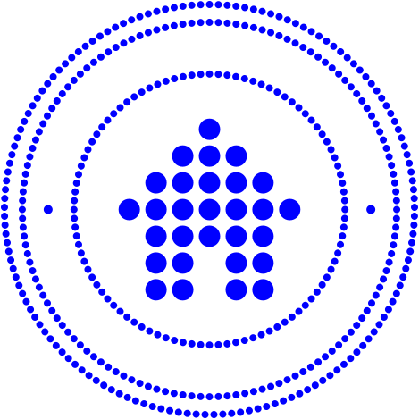

# Homebase Academy logo concepts

Four ways to draw Homebase Academy from the Homebase logo, and a fifth that
draws nothing new. Every SVG in `concepts/` is written by
`bun scripts/academy-logos.ts` from the dot maps in `src/ui/dots.ts`, the
same maps the site and the brand kit draw the Homebase logo from. Edit those
or the script, never the files.

The first four share one wordmark: HOMEBASE over ACADEMY, 6 cells apart, set
by the brand kit's measures for its stacked and horizontal lockups. ACADEMY
needed three letters the kit did not have. C, D and Y are drawn the way the
kit draws every letter: a solid block 15 cells tall and 11 wide, traced to its
outline.

## 01 Straight A

Take two dots out of the house, the middle of its roof and the one over its
door, and it reads as an A: A for Academy, and for the grade. The same
house-shaped A takes the kit's place in ACADEMY, its crossbar overhanging the
legs as the eaves overhang the walls.

- `straight-a-mark-blue`, `straight-a-mark-white`: the mark, 27 dots on the
  house's 7 × 7 grid.
- `straight-a-horizontal-blue`, `straight-a-stacked-white`: the lockups.
- `straight-a-idea`: the house, and the A it becomes, with the two dots it
  gives up left as rings.

## 02 Fill in the dots

The house's 7 × 7 grid as an answer sheet: rings where the house leaves cells
empty, the house filled in. A course fills the house in from the ground, row by
row and each row from the middle out, so the peak goes in last.

- `fill-in-mark-blue`, `fill-in-mark-white`, `fill-in-horizontal-blue`,
  `fill-in-stacked-white`.
- `fill-in-step-0`, `fill-in-step-13`, `fill-in-step-28`: a course under way;
  the mark is step 29.
- `fill-in-small-blue`, `fill-in-small-white`: the house alone, for 48 px and
  below, where the rings blur into the dots.

## 03 Blueprint

The house traced, as the kit traces its letters, each of its cells drawn five
cells wide. Homebase is the house; the Academy is its plan. Mark and letters
share one dot size.

- `blueprint-mark-blue`, `blueprint-mark-white`, `blueprint-horizontal-blue`,
  `blueprint-stacked-white`.
- `blueprint-small-blue`, `blueprint-small-white`: the house traced at two
  cells, for 64 px and below.
- `blueprint-idea`: the house as built beside its trace.

## 04 Seal

One ring of the wordmark's dots round the house, HOMEBASE ACADEMY over it
and EST. 2026 under it in Lato 900, lettered wide, a dot at either end of the
name. The house is 3.3 times the ring's dots, as the kit's stacked logo stands
it over the letters. Round, so it fills a circular avatar and stamps a
certificate. The year is `Seal.bottom` in the script. The lettering is live
text: it renders in Lato only where Lato is installed, so set it in outlines
before it goes to print.

For icons, and for lockups beside the wordmark where the name is already
written, the ringed house drops the lettering: its ring sits tighter round the
house, in dots twice the size, so it still reads as a ring at 32 px.

- `seal-blue`, `seal-white`: the seal.
- `seal-small-blue`, `seal-small-white`: the ringed house.
- `seal-horizontal-blue`, `seal-stacked-white`: the ringed house with the
  wordmark.

## 05 Endorsed

No new drawing: the kit's horizontal Homebase logo with ACADEMY beside it in
Lato 900, in a pill like the brand deck's tags. It ships today, but the
Academy gets no mark of its own, so its avatar and favicon are Homebase's.

## Wordmarks

- `academy-wordmark-blue`: ACADEMY in the kit's letters.
- `academy-wordmark-peaked-blue`: ACADEMY with 01's A.
